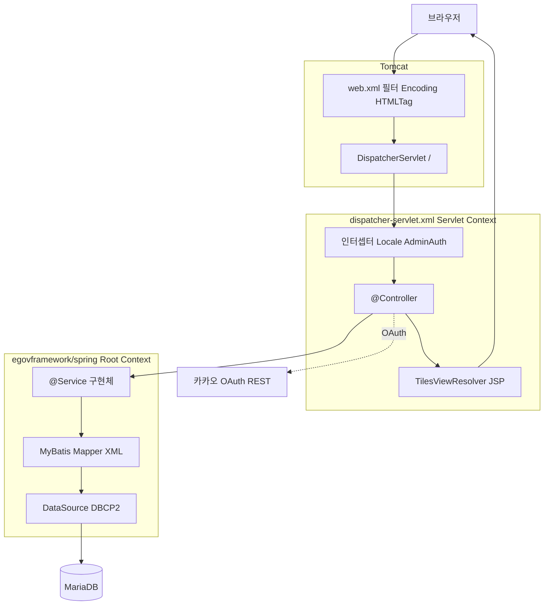
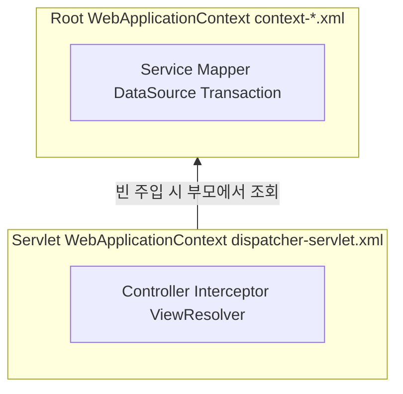
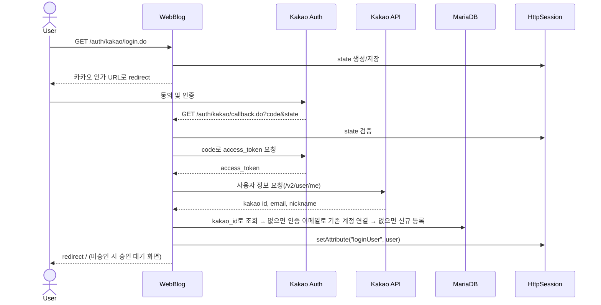

# webblog (eGovFrame 4.3.0)

전자정부프레임워크 4.3.0 기반의 웹 블로그 프로젝트입니다.  
Spring MVC + MyBatis + Tiles 구조로 구성되어 있으며, 로그인은 카카오 OAuth 간편로그인만 지원합니다.

## 1) 프로젝트 개요

- 프레임워크: eGovFrame Runtime 4.3.x
- 빌드: Maven (`war` 패키징)
- 뷰: JSP + Tiles
- DB 접근: MyBatis Mapper
- 인증:
  - 카카오 OAuth 2.0 로그인만 사용 (`KAKAO_REST_API_KEY` 환경변수 사용)
  - 이메일 일반 로그인·회원가입은 제거됨(첫 카카오 로그인 시 계정 자동 생성)
- 관리자 보호:
  - `/admin/**` 경로 인터셉터 기반 접근 제어
  - 세션 로그인 + `SUPER_ADMIN` 역할 필수

### 프로젝트 전체 흐름도

아래 다이어그램은 **한 번의 HTTP 요청**이 어떤 계층을 거쳐 DB·뷰까지 도달하는지 요약한 것입니다.



**Spring 컨텍스트 관계**(부모·자식):



- **Root** 에서는 `@Controller` 를 제외한 컴포넌트 스캔, **Servlet** 쪽에서만 `@Controller` 를 스캔해 역할이 겹치지 않습니다.
- 카카오 로그인은 **Controller** 가 외부 HTTPS API를 호출한 뒤, 동일 흐름으로 **Service·DB** 에 사용자를 반영하고 **세션**에 로그인 정보를 둡니다.

## 2) 기술 스택

- Java 8
- Spring Framework 5.3.x
- eGovFrame RTE 4.3.0
- MyBatis 3.5.x, mybatis-spring 2.1.x
- MariaDB JDBC Driver 3.4.x
- Apache Tiles 3
- JSP/JSTL
- Maven

## 교육용 자료 (5주 실습 교안)

- PowerPoint: `docs/webblog_20260429.pptx`  
  (1주: 전체 흐름·환경·설정·DB, 2주: 카카오 인증, 3주: 블로그 관리, 4주: 테스트, 5주: 2-tier 배포)
- 슬라이드 재생성(내용 수정 후): `pip install python-pptx` 후 `python docs/build_practice_pptx.py`
- PRD 문서(학생 설명용): `docs/PRD_학생용_블로그플랫폼.md`
- 수업 발표 대본(40분/20페이지): `docs/수업발표용_40분_20페이지_블로그PRD.md`
- 수업 발표 PPT(40분/20페이지): `docs/수업발표용_40분_20페이지_블로그PRD.pptx`
- 발표 PPT 재생성 스크립트: `docs/build_prd_40min_pptx.py`
- 수업 발표 PPT v2(디자인 보강): `docs/수업발표용_40분_20페이지_블로그PRD_v2.pptx`
- 발표 PPT v2 재생성 스크립트: `docs/build_prd_40min_pptx_v2.py`
- 수업 발표 PPT v3(학교정보/로고/스크린샷 자동삽입): `docs/수업발표용_40분_20페이지_블로그PRD_v3.pptx`
- 발표 PPT v3 재생성 스크립트: `docs/build_prd_40min_pptx_v3.py`

## 3) 현재 주요 기능

- 회원
  - 카카오 OAuth 간편 로그인·로그아웃(세션). 첫 로그인 시 `BLOG_MEMBER`·미승인으로 계정 생성
  - 카카오가 **인증한 이메일**이 기존(이메일 가입) 계정과 같으면 그 계정에 카카오 ID 연결
  - **슈퍼 관리자 승인(`is_approved`) 후** 서비스 이용(미승인 시 로그인해도 대기 화면)
- 블로그
  - 공개 블로그 탐색, 블로그 상세(공개는 비로그인 조회 가능 / 비공개는 소유자·멤버만)
  - **블로그 개설**(`/blog/setup/create.do`): 승인 + `can_create_blog` + 소유 블로그 없음
  - **멤버 가입**(공개 블로그): 가입 후 ACTIVE 멤버는 해당 블로그 게시판에 **원글** 작성 가능
  - 멤버 목록·상태 변경(소유자 전용)
- 게시판·게시글
  - 블로그 하위 **게시판(`board`)** 목록·추가·삭제(소유자, `can_create_board` 및 `blog.board_limit` 이내)
  - 게시글: 게시판별 목록·상세·작성·수정·삭제
  - **답글(`post.parent_post_id`)**: 블로그 소유자(관리자)만 작성, 멤버는 원글만 작성
  - 레이아웃 **반응형**(viewport + flex, `layout.jsp`)
- 금지어(블랙리스트)
  - 게시글/답글 등록·수정 시 **전역 + 블로그별** 금지어 및 개인정보 패턴 검사
  - 차단된 등록 시도는 `moderation_violations`에 기록(관리자 검색 「위반 시도 로그」·리포트에서 조회)
  - 슈퍼 관리자: 전역 금지어 UI(`/admin/blacklist.do`)
  - 블로그 소유자: 블로그 전용 금지어 UI(`/blog/{blogId}/blacklist.do`)
- 슈퍼 관리자
  - 회원 승인·블로그/게시판 생성 권한·쿼터·이미지 제한·보호 플래그 설정
  - 블로그 전역 설정, 전역 금지어 관리

## 3-1) 요청 요구사항 대비 점검표 (2026-05 기준)

| 구분 | 상태 |
|------|------|
| 가입(첫 카카오 로그인) 후 슈퍼 관리자 승인 후 이용 | 구현 (`blog_user.is_approved`, 로그인·홈 라우팅) |
| 로그인 사용자 자신의 블로그 생성 | 구현 (`/blog/setup/create.do`, 권한 검증) |
| 게시판 생성·관리·응답형 UI | 구현 (`board` 테이블, 소유자 관리, 반응형 레이아웃) |
| 멤버 가입 후 게시판 글쓰기 | 구현 (공개 블로그 가입 + `canWritePost`) |
| 답글은 블로그 관리자(소유자)만 | 구현 (`PostServiceImpl` + `parent_post_id`) |
| 블랙리스트 금지어 | 구현 (저장 시 검사 + 관리 화면) |

### 아직 없거나 제한적인 항목

- 게시글 **비밀번호·비밀글** 열람 정책
- 댓글/대댓글 트리(현재는 **게시글 단위 답글 1단**만)
- 프로필 확장 UI( DB 컬럼 일부는 존재할 수 있음 )

## 3-2) 변경 이력

### 2026-10

- **로그인**: 이메일만으로 로그인되던 일반 로그인(`POST /auth/login.do`)과 회원가입(`/auth/register.do`) 제거 → 카카오 로그인만 허용
  - 카카오 인증 이메일이 기존 미연동 계정과 같으면 그 계정에 카카오 ID 연결
  - 카카오 신규 가입자 role `USER` → `BLOG_MEMBER`, 신규 가입 직후 세션 `userId`가 비던 문제 수정
  - 로그인 화면 메시지 XSS 수정(`c:out`)
- **멤버 상태 변경**: 다른 블로그의 `memberId`로 상태를 바꿀 수 있던 문제 수정(`blog_id` 조건 + 상태값 검증)
- **관리자 검색**: 존재하지 않는 테이블·컬럼·쿼리 참조 수정(`AdminSearchMapper.xml`)
- **위반 기록**: 금지어·개인정보로 차단된 등록 시도를 `moderation_violations`에 기록(별도 트랜잭션)
- **DB 스크립트**: `05_moderation_violations_and_access_log.sql`, `06_promote_super_admin.sql` 추가
- **메뉴**: 「블로그 개설」 노출 조건을 `can_create_blog` 기준으로 변경(`BLOG_ADMIN` 역할 조건 제거)
- **회원·블로그 삭제**: FK(`ON DELETE RESTRICT`) 오류로 실패하던 문제 수정 — 글 → 게시판 → 블로그(→ 회원) 순으로 한 트랜잭션에서 삭제, 관리자 본인 계정 삭제 차단
- **세션 갱신**: 승인·권한 변경이 재로그인 전까지 반영되지 않던 문제 수정(`SessionUserRefreshInterceptor`)
- **CSRF 방어**: `CsrfTokenInterceptor` 추가 — 세션당 토큰 발급, POST 요청은 `_csrf` 파라미터(또는 `X-CSRF-Token` 헤더) 검증, 모든 POST 폼에 hidden 필드 추가
- **답글 권한**: 답글 등록 시 블로그 읽기 권한·소유자 여부·원글 소속을 컨트롤러에서도 검증
- **폼 바인딩**: 관리자 블로그 설정·게시글 작성/수정에서 폼 값을 VO 에 통째로 바인딩하지 않고 허용 항목만 받도록 변경, 관리자 입력값 범위 제한. 관리자 블로그 설정의 게시판·이미지 한도가 저장되지 않던 문제 수정
- **redirect URL**: 모든 redirect 에 `?memberCount=N` 이 붙던 문제 수정(`ignoreDefaultModelOnRedirect`)
- **HTTP 상태**: 잘못된 메서드(405)·파라미터(400)가 500 으로 응답되던 문제 수정(`DefaultHandlerExceptionResolver`), 미사용 BASIC `login-config` 제거(Jetty 등에서 기동 실패 원인)
- **05 스크립트**: 예전 구조의 `moderation_violations` 테이블이 이미 있으면 필요한 컬럼·FK 를 추가하도록 보강(재실행 안전)
- **통합 테스트**: `WebBlogIntegrationTest` 추가(§10 참고)
- **세션 보안**: 카카오 로그인 성공 시 세션 ID 재발급(세션 고정 공격 방지)·CSRF 토큰 재발급, 로그아웃 시 세션 전체 폐기, 세션 쿠키 HttpOnly·URL `;jsessionid` 노출 차단·30분 만료(`web.xml` `session-config`, HTTPS 운영 시 `secure` 주석 해제)
- **로그**: OAuth state·인가 URL·이메일을 INFO 로그에서 제거
- **카카오 API**: 연결 3초·응답 5초 타임아웃
- **블로그 대신 만들어 주기**: 옛 역할명 `ADMIN` 검사를 `SUPER_ADMIN` 으로 수정
- **페이지 나누기**: 게시글 목록·블로그 찾기(`pageIndex`), 관리자 대시보드 블로그(`blogPage`)·회원(`userPage`), 관리자 블로그 목록에 10개씩 페이지 적용(eGov `PaginationInfo` + `<ui:pagination>`, `PagingUtil`)
- **저장소 정리**: 저장소 루트의 `target/` 빌드 결과물을 git 추적에서 제거하고 루트 `.gitignore` 추가
- **오류 화면**: `common/error.jsp`가 예외 메시지·스택 트레이스를 노출하던 문제 수정(서버 로그에만 기록), 404 시 오류 페이지 자체가 NPE 나던 문제 수정, 예외 뷰(`cmmn/*`)·`admin/search`·`admin/report` 뷰가 경로 오류로 404 나던 문제 수정

### 2026-05

#### DB 스키마

- `01_create_tables.sql`
  - `blog_user.is_approved` 기본값 `0`(신규 가입자 미승인)
  - `board` 테이블 추가(블로그별 게시판)
  - `post`에 `board_id`, `parent_post_id` 추가(원글/답글, 게시판 소속)
  - `blog_member`에 `(blog_id, user_id)` 유니크
- **기존 DB**용 마이그레이션: `src/main/resources/db/mariadb/04_board_reply_and_member_unique.sql`  
  (게시판 생성·기본 게시판 시드·`post` 컬럼·FK·멤버 유니크 등, idempotent에 가깝게 구성)

#### 애플리케이션

- `UserServiceImpl`: 가입 시 역할과 무관하게 **`approved=false`**
- `AuthController` / `HomeController`: `SUPER_ADMIN` 제외 **미승인 사용자는 승인 대기 화면**으로 유도
- `BlogService` / `BlogController`: 공개 블로그 목록, 블로그 개설, 멤버 가입, 게시판 CRUD, 블로그별 블랙리스트
- `BoardService` / `BoardMapper`: 게시판 도메인
- `PostController` / `PostService` / `PostMapper`: 게시판별 URL, 답글 전용 POST, 미승인 사용자 글쓰기 차단
- `ModerationService`: 전역·블로그 금지어 목록/추가/삭제 API 확장
- `AdminController`: `/admin/blacklist.do` 전역 금지어 관리
- `layout.jsp` / `menu.jsp`: 반응형 레이아웃, 블로그 찾기·개설 링크
- `tiles.xml` 및 JSP: 탐색·개설·게시판·블랙리스트·관리자 금지어 화면 추가

## 3-3) 사용법 가이드

### 용어

- **슈퍼 관리자(`SUPER_ADMIN`)**: `/admin/**` 접근, 전역 금지어·회원 승인·블로그 설정
- **블로그 관리자(블로그 소유자)**: 자신이 소유한 블로그의 게시판·멤버·블랙리스트·답글 관리. 슈퍼 관리자가 `can_create_blog`를 켜 주면 블로그를 개설할 수 있습니다(`BLOG_ADMIN` 역할 값은 관리자 화면 표시용).
- **블로그 멤버(`BLOG_MEMBER`)**: 첫 카카오 로그인 시 기본 역할; 다른 사람의 공개 블로그에 **멤버 가입** 후 원글 작성 가능

### 처음 세팅(운영자)

1. DB 스크립트 순서대로 실행: `00` → `01` → **`05_moderation_violations_and_access_log.sql`**  
   - 기존 DB였다면 `03_migrate_to_super_admin_model.sql`에 이어 **`04_board_reply_and_member_unique.sql`**, **`05`** 실행
2. **슈퍼 관리자 지정**: 관리자로 쓸 카카오 계정으로 한 번 로그인(승인 대기 화면이 보이면 정상) → `06_promote_super_admin.sql`의 `@kakao_id`를 바꿔 실행 → 새로고침하면 바로 관리자 메뉴가 보임  
   - `02_seed_admin_optional.sql`의 시드 계정(`admin@example.com`)은 이메일 로그인이 제거되어 더 이상 로그인할 수 없습니다.
3. 슈퍼 관리자로 `/admin/dashboard.do`에서 신규 회원 **승인** 체크 및 권한 부여
4. **블로그를 운영할 사람**에게는 **`can_create_blog`** 를 켜 주고, 게시판까지 쓰게 하려면 **`can_create_board`** 도 켜 줍니다.  
   - 블로그당 게시판 개수 상한은 `blog.board_limit`(슈퍼 관리자가 `/admin/blogs.do` 등에서 조정)

### 블로그 관리자(사이트 사용자)

1. 카카오로 로그인(첫 로그인 시 계정 생성) → 슈퍼 관리자가 **승인** + **블로그 생성** 권한 부여
2. 로그인 후 메뉴 **「블로그 개설」** 또는 `/blog/setup/create.do` 에서 이름 입력 후 개설(기본 게시판 자동 생성)
3. `/blog/{blogId}/boards.do`에서 게시판 추가(권한·상한 내)
4. `/blog/{blogId}/blacklist.do`에서 블로그 전용 금지어 등록
5. 멤버 관리: `/blog/{blogId}/members.do`에서 상태(ACTIVE 등) 변경
6. 게시글 상세에서 **답글** 작성(멤버는 답글 폼이 보이지 않음)

### 다른 블로그에 참여만 하는 사용자

1. 카카오로 로그인 후(승인 필요) `/blog/explore.do`에서 공개 블로그 선택
2. 블로그 보기 화면에서 **「이 블로그에 멤버로 가입」** (공개 블로그만)
3. 승인된 계정으로 `/blog/{blogId}/boards.do` → 게시판 → **글쓰기**(원글만; 답글은 소유자만)

### URL 빠른 참조

| 목적 | URL |
|------|-----|
| 공개 블로그 목록 | `/blog/explore.do` |
| 블로그 개설 | `/blog/setup/create.do` |
| 블로그 홈·가입 | `/blog/{blogId}/view.do` |
| 게시판 목록·관리 | `/blog/{blogId}/boards.do` |
| 글 목록 | `/post/{blogId}/board/{boardId}/list.do` |
| 전역 금지어 | `/admin/blacklist.do` |
| 블로그 금지어 | `/blog/{blogId}/blacklist.do` |

자세한 URL 목록은 **§8 주요 URL**을 참고합니다.

## 4) 최근 반영된 수정 사항

> **2026-05** 블로그·게시판·승인·블랙리스트·답글 권한 등 큰 변경은 **§3-2 변경 이력**, 사용 절차는 **§3-3 사용법 가이드**에 정리했습니다.

### (A) MVC/Tiles 동작 보정

- `dispatcher-servlet.xml`
  - 컨트롤러 스캔 대상을 `egovframework,com.chan`로 확장
  - Tiles 설정(`TilesConfigurer`, `TilesViewResolver`) 연결
- `index.jsp`
  - 샘플 URL 포워딩에서 `/` 홈 포워딩으로 변경
- 누락 뷰 추가
  - `home.jsp`
  - `blog/blogView.jsp`
  - `blog/memberList.jsp`
  - `admin/blogList.jsp`

### (B) 카카오 OAuth 간편로그인 구현

- `AuthController`
  - `GET /auth/kakao/login.do` 추가
    - 인가 URL 생성 및 `state` 세션 저장
  - `GET /auth/kakao/callback.do` 보강
    - `state` 검증
    - 토큰 교환 (`https://kauth.kakao.com/oauth/token`)
    - 사용자 정보 조회 (`https://kapi.kakao.com/v2/user/me`)
    - 카카오 사용자 신규 등록/기존 사용자 조회
    - 세션 로그인 처리 (`loginUser`)
- `login.jsp`
  - 하드코딩 카카오 URL 제거
  - `/auth/kakao/login.do` 사용
  - 키 누락/권한 오류 메시지 출력 추가

### (C) 로그인 세션 연동

- ~~`POST /auth/login.do` (이메일 기반 일반 로그인)~~ — 2026-10 제거(카카오 로그인만 허용)
- 로그인 성공 시 `loginUser` 세션 저장
- `GET /auth/logout.do` 구현
- `menu.jsp`에서 로그인 상태에 따라 메뉴 분기

### (D) 관리자 접근 제어

- `AdminAuthInterceptor` 추가
  - 세션 미로그인: `/auth/login.do?error=login_required`
  - 비관리자: `/auth/login.do?error=admin_only`
- `dispatcher-servlet.xml`에 `/admin/**` 인터셉터 매핑

### (E) 빌드 경고 정리

- `pom.xml`
  - `${artifactId}`, `${version}` deprecated 표현식 정리
  - `project.build.sourceEncoding` 추가

## 5) 프로젝트 구조(핵심)

```text
src/main/java/com/chan
├─ web
│  ├─ HomeController.java
│  ├─ AuthController.java
│  ├─ AdminController.java
│  ├─ BlogController.java
│  ├─ PostController.java
│  └─ interceptor/AdminAuthInterceptor.java
├─ service
│  ├─ BoardService.java
│  └─ impl (BlogServiceImpl, PostServiceImpl, BoardServiceImpl, ModerationServiceImpl, …)
├─ mapper (BlogMapper, PostMapper, BoardMapper, ModerationMapper, UserMapper, …)
└─ vo (BlogVO, BoardVO, PostVO, …)

src/main/resources
├─ egovframework/spring/*.xml
├─ egovframework/sqlmap/mappers/*.xml
├─ db/sampledb.sql
└─ db/mariadb/*.sql

src/main/webapp
├─ WEB-INF/config/egovframework/springmvc
│  ├─ dispatcher-servlet.xml
│  └─ tiles.xml
└─ WEB-INF/jsp
   ├─ auth
   ├─ admin
   ├─ blog
   ├─ post
   └─ layout
```

## 5-1) `egovframework/spring` 컨텍스트 — 용도·로딩·사용 방법

### 로딩 방식

`web.xml`의 `contextConfigLocation`에 다음이 지정되어 있습니다.

```text
classpath*:egovframework/spring/context-*.xml
```

`ContextLoaderListener`가 **Root WebApplicationContext**를 만들 때 위 패턴에 맞는 XML을 한꺼번에 읽습니다.  
(서블릿용 `dispatcher-servlet.xml`과는 별개입니다. 디스패처는 **자식 컨텍스트**에 가깝게 동작합니다.)

일반적인 사용 흐름은 다음과 같습니다.

1. **공통·인프라** 빈 등록 (`dataSource`, `SqlSessionFactory`, 트랜잭션, AOP 등)
2. **`@Controller` 제외** 컴포넌트 스캔으로 서비스·리포지토리 계층 등록 (`context-common.xml`)
3. 컨트롤러는 `dispatcher-servlet.xml`에서만 스캔

`${db.url}` 같은 치환은 `PropertySourcesPlaceholderConfigurer`(`context-properties.xml`)가 처리합니다.

### 파일별 요약

| 파일 | 주요 역할 |
|------|-----------|
| `context-properties.xml` | `database.properties`·`~/.webblog/database.properties` 로드, `db.*` 치환 준비. eGov `propertiesService`(페이지 단위 등 샘플용 맵) |
| `context-datasource.xml` | `dataSource` 빈(DBCP2). `WEBBLOG_DB_*` 환경변수와 `db.*` 조합 |
| `context-common.xml` | `egovframework`, `com.chan` 패키지 스캔(**`@Controller` 제외**). `messageSource`, eGov 추적(`LeaveaTrace`) 빈 |
| `context-mapper.xml` | MyBatis `SqlSessionFactoryBean`, `mapperLocations`, `MapperScannerConfigurer`로 `com.chan.mapper`(`@Mapper`) 인터페이스를 빈 등록 후 XML 매퍼와 연결 |
| `context-transaction.xml` | `DataSourceTransactionManager`, `tx:advice`, `com.chan..impl.*Impl` 메서드에 트랜잭션 AOP |
| `context-aspect.xml` | eGov `ExceptionTransfer` AOP. **포인트컷이 `egovframework.example..impl.*Impl` 한정**(샘플). `com.chan` 서비스에는 기본 적용되지 않음 |
| `context-idgen.xml` | eGov 표준 ID 생성(`IDS` 테이블·`SAMPLE` 등). 샘플 연동용. 블로그 테이블은 MyBatis `useGeneratedKeys` 위주 |
| `context-validator.xml` | Commons Validator 연동(`beanValidator`, `validator-rules.xml`, `validator.xml`). 샘플 JSP 검증 등에 사용 |

### 사용·수정 시 참고

- **DB만 바꿀 때**  
  - `context-datasource.xml`을 직접 고치기보다 `database.properties`, `~/.webblog/database.properties`, 환경변수 `WEBBLOG_DB_*` 로 조정하는 것을 권장합니다.
- **새 Mapper 추가**  
  - 인터페이스: `com.chan.mapper` 패키지  
  - XML: `egovframework/sqlmap/mappers/*.xml` (`context-mapper.xml`의 `mapperLocations`와 일치)
- **트랜잭션 범위**  
  - `context-transaction.xml`의 `pointcut`이 `com.chan..impl.*Impl` 이므로, 서비스 구현체 클래스명이 `*Impl`이고 해당 패키지 아래에 있어야 합니다. 패키지·이름 규칙을 바꾸면 표현식도 함께 수정해야 합니다.
- **예외를 eGov 방식으로 통일하고 싶을 때**  
  - `context-aspect.xml`의 `execution` 표현식에 `com.chan..impl` 등을 추가하거나, 별도 `@ControllerAdvice` 등으로 보완할 수 있습니다.
- **검증(Validator)**  
  - `context-validator.xml`은 `WEB-INF/config/egovframework/validator/` 아래 규칙 파일을 참조합니다. 폼 검증을 쓰는 화면만 연동하면 됩니다.

## 5-2) `dispatcher-servlet.xml` — 정의·역할·주요 설정

### 정의와 로딩 위치

- **파일 경로:** `src/main/webapp/WEB-INF/config/egovframework/springmvc/dispatcher-servlet.xml`
- **web.xml 연결:** `DispatcherServlet`(서블릿 이름 `action`)의 `init-param` `contextConfigLocation`에 위 파일이 지정되어 있습니다.
- **URL 매핑:** 같은 서블릿이 `<url-pattern>/</url-pattern>` 이므로, 정적 리소스·JSP 제외 규칙을 제외하면 대부분의 요청이 이 설정을 따르는 **프론트 컨트롤러**입니다.

### Root Context와의 관계

- `ContextLoaderListener`가 읽는 `egovframework/spring/context-*.xml` → **Root** `WebApplicationContext` (서비스, DB, MyBatis 등).
- `DispatcherServlet`이 읽는 `dispatcher-servlet.xml` → **Servlet** `WebApplicationContext` (주로 `@Controller`, MVC 인프라).
- 서블릿 컨텍스트는 루트를 **부모**로 두므로, 컨트롤러에서 `@Resource` / `@Autowired` 로 `userService` 같은 **루트에 등록된 빈**을 주입할 수 있습니다.
- **중복 스캔 방지:** 루트(`context-common.xml`)는 `@Controller`를 제외하고, 디스패처 쪽은 `@Controller`만 포함하도록 나뉘어 있습니다.

### 주요 설정 블록 (파일 구성 기준)

| 구역 | 내용 |
|------|------|
| **컴포넌트 스캔** | `egovframework`, `com.chan` 중 **`@Controller`만** 포함. `@Service`, `@Repository`는 제외 → 비즈니스 빈은 루트에서만 관리 |
| **RequestMappingHandlerAdapter** | `EgovBindingInitializer` 연동 — eGov 샘플에서 쓰는 바인딩/날짜 등 초기화 관례 |
| **RequestMappingHandlerMapping** | `interceptors`: `localeChangeInterceptor`, `adminAuthInterceptor` 순서로 등록 |
| **Locale** | `SessionLocaleResolver` + `LocaleChangeInterceptor` (`?language=...` 파라미터로 로케일 변경) |
| **관리자 인터셉터** | `MappedInterceptor`: URL 패턴 `/admin/**` 에만 `AdminAuthInterceptor` 적용 (세션·`SUPER_ADMIN` 역할 검사) |
| **예외 뷰** | `SimpleMappingExceptionResolver` — 데이터 접근/트랜잭션/eGovBiz 등 예외별 JSP 뷰 이름(`cmmn/...`) 매핑 |
| **Tiles** | `TilesConfigurer` → `tiles.xml` 로드. `TilesViewResolver` **order=1** — 컨트롤러가 반환한 논리 뷰 이름이 Tiles 정의와 맞으면 레이아웃 적용 |
| **JSP 폴백** | `UrlBasedViewResolver` **order=2**, 접두사 `/WEB-INF/jsp/egovframework/example/` — **샘플 eGov JSP** 경로. Tiles에 없는 샘플 뷰용 |
| **페이지네이션** | eGov `DefaultPaginationManager` + `EgovImgPaginationRenderer` (샘플 목록 등에서 사용 시) |
| **노컨트롤러 URL** | `<mvc:view-controller path="/cmmn/validator.do" view-name="cmmn/validator"/>` — 검증 데모 페이지 직매핑 |

### 뷰 이름과 실제 화면

- 블로그·인증 등은 컨트롤러가 `home`, `auth/login`, `blog/blogView` 같은 **논리 이름**을 반환하고, **1순위 Tiles**가 `tiles.xml`의 definition과 매칭합니다.
- `cmmn/egovError` 등은 **2순위 JstlView**로 `.../egovframework/example/cmmn/` 아래 JSP로 해석됩니다.

### 수정·확장 시 자주 건드리는 부분

- **새 컨트롤러 패키지**  
  - `context:component-scan` 의 `base-package`에 패키지 추가, 또는 기존 `com.chan` 하위에 두기.
- **인터셉터 추가**  
  - `RequestMappingHandlerMapping` 의 `interceptors` 리스트에 빈 참조 추가, 또는 `MappedInterceptor` 빈을 더 등록.
- **관리자 URL 범위 변경**  
  - `adminAuthInterceptor` 의 첫 번째 `constructor-arg` 배열의 패턴 수정.
- **Tiles 외 단순 JSP**  
  - 새 논리 뷰를 Tiles에 넣거나, `UrlBasedViewResolver`의 prefix를 바꾸면 전체 JSP 규칙이 바뀌므로 보통은 **Tiles definition 추가**를 권장합니다.

## 6) 실행 전 필수 설정

### 6-1. DB 설정

데이터소스 값은 **OS 환경변수**와 **`db.*` 프로퍼티(파일)** 가 함께 쓰이며, 실제 JDBC 설정은 `context-datasource.xml`에서 조합됩니다.

- Spring Bean 정의: `src/main/resources/egovframework/spring/context-datasource.xml`  
  (`${WEBBLOG_DB_JDBC_URL:${db.url}}` 처럼 **환경변수가 있으면 그 값**, 없으면 아래 파일에서 읽은 `db.*` 사용)
- 프로퍼티 로딩: `src/main/resources/egovframework/spring/context-properties.xml`  
  - ① classpath: `egovframework/properties/database.properties`  
  - ② (있을 때만) `file:${user.home}/.webblog/database.properties` — **같은 키(`db.url` 등)는 이 파일이 classpath보다 우선**(나중에 로드되는 쪽이 덮어씀)

**최종 적용 우선순위 (높음 → 낮음)**

1. **OS 환경변수** `WEBBLOG_DB_*` — XML에서 가장 바깥 플레이스홀더로 조회  
2. **`${user.home}/.webblog/database.properties`** 의 `db.*` (파일이 존재할 때)  
3. **classpath** `egovframework/properties/database.properties` 의 `db.*` — 저장소에 포함된 **로컬 개발용 폴백**; 운영에서는 비밀번호를 여기 두지 말 것

프로퍼티 키(파일에서 사용):

- `db.driverClassName`
- `db.url`
- `db.username`
- `db.password`

**환경변수 키 (설정 시 파일 기본값 대신 사용)**

| 환경변수 | 대응 항목 | 설명 |
|----------|-----------|------|
| `WEBBLOG_DB_JDBC_URL` | JDBC URL | 예: `jdbc:mariadb://호스트:3306/pub_blog?useUnicode=true&characterEncoding=UTF-8` |
| `WEBBLOG_DB_USERNAME` | DB 사용자 | |
| `WEBBLOG_DB_PASSWORD` | DB 비밀번호 | |
| `WEBBLOG_DB_DRIVER` | 드라이버 클래스 | 생략 시 `db.driverClassName` (기본 MariaDB 드라이버) |

운영·수업 서버에서는 비밀번호를 파일에 두지 않고 **`WEBBLOG_DB_PASSWORD` 등 환경변수만** 쓰는 방식을 권장합니다.  
환경변수를 바꾼 뒤에는 **Tomcat(또는 IDE 서버)을 재시작**해야 반영됩니다.

#### Windows에서 DB 환경변수 예시

**CMD (현재 창만)**

```bat
set WEBBLOG_DB_JDBC_URL=jdbc:mariadb://127.0.0.1:3306/pub_blog?useUnicode=true^&characterEncoding=UTF-8
set WEBBLOG_DB_USERNAME=pub_blog_users
set WEBBLOG_DB_PASSWORD=여기에_비밀번호
```

※ CMD에서 `&`는 특수문자이므로 URL에 포함할 때는 `^&`로 이스케이프하거나, 값 전체를 따옴표로 감쌉니다.

```bat
set "WEBBLOG_DB_JDBC_URL=jdbc:mariadb://127.0.0.1:3306/pub_blog?useUnicode=true&characterEncoding=UTF-8"
```

**PowerShell (현재 세션)**

```powershell
$env:WEBBLOG_DB_JDBC_URL = "jdbc:mariadb://127.0.0.1:3306/pub_blog?useUnicode=true&characterEncoding=UTF-8"
$env:WEBBLOG_DB_USERNAME = "pub_blog_users"
$env:WEBBLOG_DB_PASSWORD  = "여기에_비밀번호"
```

**영구 등록(Windows)** 은 아래 **6-2절 · Windows · 방법 B/C** 의 GUI / `setx` 와 동일하게 **사용자 또는 시스템 환경 변수**에 위 이름으로 추가하면 됩니다.

```bat
setx WEBBLOG_DB_USERNAME "pub_blog_users"
setx WEBBLOG_DB_PASSWORD "여기에_비밀번호"
```

JDBC URL은 길고 `&`가 포함되므로 **GUI로 `WEBBLOG_DB_JDBC_URL` 등록**하거나, `setx` 사용 시 따옴표로 감싸는 것이 안전합니다.

#### Linux에서 DB 환경변수

**현재 셸에서만 (일시)**

```bash
export WEBBLOG_DB_JDBC_URL='jdbc:mariadb://127.0.0.1:3306/pub_blog?useUnicode=true&characterEncoding=UTF-8'
export WEBBLOG_DB_USERNAME='pub_blog_users'
export WEBBLOG_DB_PASSWORD='여기에_비밀번호'
# 선택
export WEBBLOG_DB_DRIVER='org.mariadb.jdbc.Driver'
```

JDBC URL에 `&`가 있으므로 **작은따옴표**로 감싸면 셸이 끊지 않습니다. 확인: `echo "$WEBBLOG_DB_JDBC_URL"`.

**로그인할 때마다 적용 (사용자 계정)**

`~/.bashrc` 또는 `~/.bash_profile` (배포판에 따라 다름) 끝에 위 `export` 줄을 추가한 뒤 `source ~/.bashrc`.

**모든 사용자·서비스에 공통 (시스템)**

- Debian/Ubuntu 계열: `/etc/environment` 에 `KEY="value"` 형식으로 추가 (재부팅 또는 재로그인 후 반영). JDBC URL은 따옴표 필수.
- 또는 `/etc/profile.d/webblog.sh` 를 만들고 `export` 나열, `chmod +x` 후 재로그인.

**systemd로 Tomcat(또는 커스텀 유닛) 실행 시**

서비스 단위로 넣는 것이 가장 명확합니다.

```bash
sudo systemctl edit tomcat
```

편집기에 예시:

```ini
[Service]
Environment="WEBBLOG_DB_JDBC_URL=jdbc:mariadb://db서버:3306/pub_blog?useUnicode=true&characterEncoding=UTF-8"
Environment="WEBBLOG_DB_USERNAME=pub_blog_users"
Environment="WEBBLOG_DB_PASSWORD=비밀번호"
Environment="KAKAO_REST_API_KEY=카카오_REST_키"
```

저장 후 `sudo systemctl daemon-reload && sudo systemctl restart tomcat`  
(유닛 이름은 `tomcat9` 등 실제 서비스명에 맞출 것.)

비밀번호는 가능하면 **systemd `EnvironmentFile=`** 로 root만 읽는 파일(`/etc/webblog.env`, `chmod 600`)에 두는 방식을 권장합니다.

```ini
[Service]
EnvironmentFile=/etc/webblog.env
```

`/etc/webblog.env` 예:

```properties
WEBBLOG_DB_PASSWORD=비밀번호
KAKAO_REST_API_KEY=키값
```

#### MariaDB: 데이터베이스·사용자·권한·테이블 생성

프로젝트에 SQL 스크립트가 포함되어 있습니다.

| 순서 | 파일 | 설명 |
|------|------|------|
| 1 | `src/main/resources/db/mariadb/00_create_database_and_user.sql` | DB `pub_blog` 생성, 앱 계정(`pub_blog_users`) 생성, `GRANT` |
| 2 | `src/main/resources/db/mariadb/01_create_tables.sql` | 애플리케이션 테이블 생성(MyBatis 매퍼와 동일 구조) |
| 3 | `src/main/resources/db/mariadb/02_seed_admin_optional.sql` | (선택) 테스트용 `SUPER_ADMIN` 역할 회원 삽입/갱신 |
| 4 | `src/main/resources/db/mariadb/03_migrate_to_super_admin_model.sql` | (기존 DB 업그레이드용) `SUPER_ADMIN/BLOG_ADMIN/BLOG_MEMBER` 역할 체계 + 승인/권한/제한 컬럼 마이그레이션 |
| 5 | `src/main/resources/db/mariadb/04_board_reply_and_member_unique.sql` | (기존 DB 업그레이드용) `board` 테이블·`post.board_id`/`parent_post_id`·멤버 유니크 등 |
| 6 | `src/main/resources/db/mariadb/05_moderation_violations_and_access_log.sql` | (신규·기존 모두) `moderation_violations` 테이블, 로그 DB `pub_blog_log`·`access_log` 테이블 생성 및 권한, role `USER` → `BLOG_MEMBER` 정리 |
| 7 | `src/main/resources/db/mariadb/06_promote_super_admin.sql` | 카카오로 한 번 로그인한 계정을 `SUPER_ADMIN`으로 지정(`@kakao_id` 수정 후 실행) |

**1단계(관리자 계정으로 실행)**  
스크립트 안의 비밀번호·호스트(`localhost` 등)를 환경에 맞게 수정한 뒤 실행합니다.

```bash
mysql -u root -p < src/main/resources/db/mariadb/00_create_database_and_user.sql
```

**2단계(앱 DB 계정으로 실행)**  
`database.properties`의 `db.username` / `db.password`와 동일하게 맞춥니다.

```bash
mysql -u pub_blog_users -p pub_blog < src/main/resources/db/mariadb/01_create_tables.sql
```

**3단계(관리자 계정으로 실행)**  
위반 기록·접속 로그 테이블을 만듭니다. 로그 DB `pub_blog_log`를 생성하고 앱 계정에 권한을 주므로 root로 실행합니다.

```bash
mysql -u root -p < src/main/resources/db/mariadb/05_moderation_violations_and_access_log.sql
```

**4단계(슈퍼 관리자 지정)**  
관리자 화면(`/admin/**`)은 세션 사용자의 `role`이 **`SUPER_ADMIN`** 이어야 합니다. 로그인은 카카오만 지원하므로, 관리자로 쓸 카카오 계정으로 먼저 한 번 로그인한 뒤 `06_promote_super_admin.sql`의 `@kakao_id`를 그 계정 값으로 바꿔 실행합니다(재로그인 없이 다음 요청부터 반영).  
(`02_seed_admin_optional.sql`의 이메일 시드 계정으로는 더 이상 로그인할 수 없습니다.)

**권한 요약**

- `00_create_database_and_user.sql` 예시는 개발 편의상 `GRANT ALL PRIVILEGES ON pub_blog.*` 를 사용합니다.
- 운영에서는 `SELECT`, `INSERT`, `UPDATE`, `DELETE`, `EXECUTE` 등 최소 권한만 부여하는 것을 권장합니다.

생성되는 주요 테이블: `blog_user`, `blog`, `board`, `blog_member`, `post`, `blacklist_word`, `moderation_violations` (+ 로그 DB `pub_blog_log.access_log`)

기존 스키마에서 최신 권한 모델로 올릴 때는 `03_migrate_to_super_admin_model.sql`을 실행한 뒤, 게시판·답글 스키마가 없다면 **`04_board_reply_and_member_unique.sql`** 을 추가 실행하세요.  
**신규 설치**에서 `01_create_tables.sql`만으로 이미 `board`·수정된 `post`가 생성되므로, 이 경우 **`04`는 실행하지 않아도 됩니다.**

외부 파일 예시 (`${user.home}/.webblog/database.properties`):

```properties
db.driverClassName=org.mariadb.jdbc.Driver
db.url=jdbc:mariadb://127.0.0.1:3306/pub_blog?useUnicode=true&characterEncoding=UTF-8
db.username=pub_blog_users
db.password=change_me
```

### 6-2. 카카오 OAuth 및 환경변수 설정 (Windows / Linux)

카카오 로그인은 코드에서 `System.getenv("KAKAO_REST_API_KEY")` 로 읽습니다.  
**애플리케이션을 기동하는 프로세스**(Tomcat, IDE 내장 서버 등)에 환경변수가 넘어가야 합니다.

#### 6-2-1. 외부 입력값을 "프로젝트 속성"으로 적용하는 방법

카카오 키/DB 비밀번호 같은 민감 값은 소스에 하드코딩하지 말고, 아래 방식 중 하나로 프로젝트 실행 속성에 주입합니다.

**방법 A) IDE 서버 실행 속성(권장, 코드 변경 없음)**

- Eclipse/Tomcat: `Servers` 뷰 -> 사용 서버 더블클릭 -> `Open launch configuration` -> `Environment` 탭
- IntelliJ/Tomcat: `Run/Debug Configurations` -> Tomcat 설정 -> `Environment variables`
- 추가 키 예시:
  - `KAKAO_REST_API_KEY=...`
  - `WEBBLOG_DB_JDBC_URL=...`
  - `WEBBLOG_DB_USERNAME=...`
  - `WEBBLOG_DB_PASSWORD=...`
- 장점:
  - 프로젝트별로 분리 관리 가능
  - OS 전역 환경변수를 건드리지 않아도 됨
  - 팀원별 로컬 키를 안전하게 분리 가능

**방법 B) Tomcat 인스턴스 속성(`setenv`)**

- Tomcat 시작 스크립트가 읽는 `setenv` 파일에 환경변수를 등록합니다.
- Windows: `%CATALINA_BASE%\\bin\\setenv.bat`
- Linux/macOS: `$CATALINA_BASE/bin/setenv.sh`

예시 (`setenv.bat`):

```bat
set "KAKAO_REST_API_KEY=실제_REST_API_키"
set "WEBBLOG_DB_JDBC_URL=jdbc:mariadb://127.0.0.1:3306/pub_blog?useUnicode=true&characterEncoding=UTF-8"
set "WEBBLOG_DB_USERNAME=pub_blog_users"
set "WEBBLOG_DB_PASSWORD=비밀번호"
```

이 방식은 "해당 Tomcat으로 실행되는 앱들"에 공통 적용됩니다.

**방법 C) Spring 외부 프로퍼티 파일로 확장(선택, 코드 변경 필요)**

현재 프로젝트는 DB용 `database.properties`만 `context-properties.xml`에서 로드합니다.  
카카오 키도 파일 기반으로 관리하려면 다음처럼 확장할 수 있습니다.

1. `context-properties.xml`에 외부 파일(예: `${user.home}/.webblog/app-secrets.properties`) 추가
2. `AuthController`에서 `System.getenv(...)` 대신 `@Value("${kakao.restApiKey:}")` 주입
3. 외부 파일 예시:

```properties
kakao.restApiKey=실제_REST_API_키
```

운영 환경에서는 파일 권한 제한(예: 600), 저장소 커밋 제외(`.gitignore`)를 반드시 적용하세요.

#### 본 프로젝트에서 쓰는 변수

| 변수명 | 필수 | 설명 |
|--------|------|------|
| `KAKAO_REST_API_KEY` | 예 | 카카오 로그인(토큰·REST API)용 REST API 키 |
| `KAKAO_MAP_API_KEY` | 아니오 | 지도 등 별도 기능 연동 시 (현재 앱 코드 미사용 가능) |

값에는 **따옴표를 넣지 않는 것**이 일반적입니다. 값 안에 공백이 있으면 따옴표로 감싸야 할 수 있습니다.

---

#### 카카오 인증(로그인) 키 신청 — 카카오 개발자

공식 포털: [Kakao Developers](https://developers.kakao.com/)

1. **가입·로그인**  
   카카오계정으로 [카카오 개발자](https://developers.kakao.com/)에 로그인합니다.
2. **애플리케이션 등록**  
   **내 애플리케이션** → **애플리케이션 추가하기** → 앱 이름(및 안내에 따른 항목) 입력 후 저장합니다.
3. **앱 키 확인**  
   해당 앱을 연 뒤 **앱 키** 탭에서 **REST API 키**를 확인합니다.  
   - 본 프로젝트 서버 코드는 인가 코드로 **액세스 토큰을 받을 때** 이 값을 `client_id` 로 사용합니다.  
   - **JavaScript 키**, **네이티브 앱 키**는 클라이언트(SDK)용이며, **서버에서 토큰 API를 호출하는 흐름에는 REST API 키**를 씁니다.
4. **카카오 로그인 켜기**  
   **제품 설정** → **카카오 로그인** → **활성화 설정**을 **ON** 으로 둡니다.
5. **Redirect URI 등록**  
   **카카오 로그인** 설정의 **Redirect URI**에, 실제 서버가 사용하는 콜백 URL을 **문자 하나까지 동일하게** 등록합니다.  
   - 앱에서 쓰는 형식: `{스킴}://{호스트}:{포트}{컨텍스트경로}/auth/kakao/callback.do`  
   - 예(루트 컨텍스트·로컬): `http://localhost:8080/auth/kakao/callback.do`  
   - 예(컨텍스트 경로가 `/webblog`인 경우): `http://localhost:8080/webblog/auth/kakao/callback.do`  
   운영 배포 시에는 **실제 도메인·HTTPS** 기준으로 같은 경로를 추가 등록합니다.
6. **동의 항목(선택)**  
   사용자 정보 API(`/v2/user/me`)에서 닉네임·이메일을 쓰려면 [카카오 로그인] **동의 항목**에서 필요한 항목(예: 닉네임, 카카오계정(이메일))을 앱 정책에 맞게 설정합니다.  
   이메일 동의가 없으면 본 프로젝트는 내부적으로 대체 이메일 형식(`kakao_{카카오ID}`)을 사용합니다.  
   기존 이메일 가입 계정을 카카오 계정에 연결하려면 **카카오계정(이메일) 동의가 필요**하며, 카카오가 인증한 이메일(`is_email_verified`)일 때만 연결됩니다.
7. **보안**  
   REST API 키는 **소스·Git에 커밋하지 말고** 환경변수 등으로만 주입합니다. 유출 시 [내 애플리케이션]에서 키 재발급·문서의 보안 가이드를 따릅니다.

자세한 메뉴 이름·스크린은 카카오에서 제공하는 **문서·공지**가 우선이며, 포털 UI 변경 시 절차가 조금 달라질 수 있습니다.

---

#### 본 프로젝트에서의 사용 방법 (연동 요약)

| 단계 | 내용 |
|------|------|
| 1 | 위 절차로 **REST API 키** 발급 후, 서버 환경에 **`KAKAO_REST_API_KEY`** 로 설정합니다. |
| 2 | 카카오 콘솔 **Redirect URI**와 서버가 만드는 콜백 URL이 **완전히 일치**하는지 확인합니다. (`AuthController`는 요청의 스킴·호스트·포트·`contextPath`를 사용해 URL을 조립합니다.) |
| 3 | 사용자는 로그인 화면에서 **「카카오로 시작하기」** → `/auth/kakao/login.do` 로 이동합니다. |
| 4 | 카카오 동의 후 `/auth/kakao/callback.do` 로 돌아오면, 서버가 토큰·회원 정보를 처리하고 세션에 `loginUser` 를 넣습니다. |
| 5 | (선택) **지도 JavaScript API** 등은 보통 **JavaScript 키**를 쓰며, 별도로 `KAKAO_MAP_API_KEY` 를 두고 프론트에서 사용할 수 있습니다. 현재 백엔드 코드는 필수로 읽지 않습니다. |

키가 없으면 `/auth/kakao/login.do` 는 로그인 페이지로 되돌리며 `error=kakao_key_missing` 을 붙입니다.

---

#### Windows

##### 방법 A: 현재 터미널에서만 (일시적)

**명령 프롬프트(CMD)**

```bat
set KAKAO_REST_API_KEY=실제_REST_API_키
set KAKAO_MAP_API_KEY=실제_지도_키
```

이 창에서 Tomcat을 실행하면 해당 프로세스에만 적용됩니다.

**PowerShell (현재 세션만)**

```powershell
$env:KAKAO_REST_API_KEY = "실제_REST_API_키"
$env:KAKAO_MAP_API_KEY  = "실제_지도_키"
```

확인:

```powershell
echo $env:KAKAO_REST_API_KEY
```

```bat
echo %KAKAO_REST_API_KEY%
```

---

##### 방법 B: 사용자/시스템에 영구 등록 (GUI)

1. **설정** → **시스템** → **정보** → **고급 시스템 설정**  
   (또는 작업 표시줄 검색에서「환경 변수」)
2. **환경 변수(N)...** 클릭
3. **사용자 변수**(본인 계정만) 또는 **시스템 변수**(모든 계정)에서 **새로 만들기**
   - 변수 이름: `KAKAO_REST_API_KEY`  
   - 변수 값: 카카오 콘솔에서 복사한 REST API 키
4. 필요 시 `KAKAO_MAP_API_KEY` 도 동일하게 추가
5. **확인**으로 닫은 뒤, **이미 떠 있던 Eclipse·IntelliJ·Tomcat·터미널은 종료 후 다시 실행**해야 새 값이 반영됩니다.

---

##### 방법 C: 명령줄로 사용자 환경변수 영구 저장 (`setx`)

CMD에서 (값에 특수문자가 많으면 GUI 권장):

```bat
setx KAKAO_REST_API_KEY "실제_REST_API_키"
setx KAKAO_MAP_API_KEY "실제_지도_키"
```

주의:

- `setx` 적용 후 **새로 연 CMD/PowerShell**부터 값이 보입니다.
- **현재 이미 열린 창**에는 자동 반영되지 않습니다.
- `setx`는 문자열 길이 제한(1024자 등)이 있어 매우 긴 값은 GUI가 안전합니다.

---

##### 방법 D: Eclipse에서 서버 실행 시 (Tomcat)

Eclipse **Servers** 뷰에서 Tomcat → **Open launch configuration** → **Environment** 탭 → **New** 로 `KAKAO_REST_API_KEY` 추가.  
이렇게 하면 **IDE에서 서버 기동할 때만** 적용되며, Windows 전역 환경변수와 별개입니다.

---

##### 방법 E: Tomcat을 Windows 서비스로 둔 경우

서비스 등록 도구(예: Tomcat의 `service.bat`, NSSM 등)에서 **서비스 환경 변수**를 지정하거나,  
시스템 환경 변수(방법 B)로 올린 뒤 **서비스 재시작**합니다.

---

#### Linux (카카오 등)

##### 현재 셸에서만

```bash
export KAKAO_REST_API_KEY='실제_REST_API_키'
export KAKAO_MAP_API_KEY='실제_지도_키'
```

같은 터미널에서 Tomcat/`catalina.sh run` 등을 실행하면 해당 프로세스(자식 포함)에 전달됩니다.

##### 영구: 사용자 셸

`~/.bashrc` 또는 `~/.profile` 에 `export` 추가 후 `source ~/.bashrc`.

##### 영구: systemd 서비스

위 **DB 설정** 절의 `systemctl edit` 예시와 같이 `Environment=` 또는 `EnvironmentFile=` 에 `KAKAO_REST_API_KEY` 를 추가합니다.  
변경 후 **데몬 리로드·서비스 재시작** 필수.

##### Tomcat만 셸 스크립트로 띄우는 경우

`$CATALINA_BASE/bin/setenv.sh` (없으면 생성, 실행 권한 부여):

```bash
export KAKAO_REST_API_KEY='실제_REST_API_키'
export WEBBLOG_DB_PASSWORD='비밀번호'
```

##### 확인

```bash
echo "$KAKAO_REST_API_KEY"
env | grep -E 'KAKAO_|WEBBLOG_DB_'
```

## 7) 빌드 및 실행

```bash
mvn clean compile
mvn package
```

생성된 WAR를 WAS(Tomcat 등)에 배포해 실행합니다.

## 8) 주요 URL

- 홈: `/`
- 로그인: `/auth/login.do`
- 로그아웃: `/auth/logout.do`
- 승인 대기 안내: `/auth/pendingApproval.do`
- 카카오 로그인 시작: `/auth/kakao/login.do`
- 카카오 콜백: `/auth/kakao/callback.do`
- 공개 블로그 목록: `/blog/explore.do`
- 블로그 개설(권한 필요): `/blog/setup/create.do`
- 블로그 보기·멤버 가입: `/blog/{blogId}/view.do`
- 게시판 목록·관리: `/blog/{blogId}/boards.do`
- 블로그별 금지어: `/blog/{blogId}/blacklist.do`
- 멤버 관리(소유자): `/blog/{blogId}/members.do`
- 게시글 목록(레거시 리다이렉트): `/post/{blogId}/list.do`
- 게시글 목록(게시판별): `/post/{blogId}/board/{boardId}/list.do`
- 게시글 상세: `/post/view/{postId}.do`
- 관리자 대시보드: `/admin/dashboard.do`
- 관리자 블로그 목록: `/admin/blogs.do`
- 관리자 전역 금지어: `/admin/blacklist.do`

## 9) 인증/권한 동작 요약

- 로그인은 카카오 OAuth만 사용. 로그인 성공 시 세션 키 `loginUser`에 `BlogUserVO` 저장
- `SessionUserRefreshInterceptor`가 매 요청마다 세션의 `BlogUserVO`를 DB 값으로 다시 읽음 → 관리자가 승인·권한·역할을 바꾸면 재로그인 없이 바로 반영, 삭제된 회원은 자동 로그아웃
- **`SUPER_ADMIN`**: 항상 `/admin/dashboard.do` 등 관리 화면 이용 가능(시드 시 `is_approved=1` 권장)
- **그 외 역할**: `is_approved == false` 이면 소유 블로그·멤버 블로그가 있어도 **승인 대기 화면**(`auth/pendingApproval`)으로 보내지며, 글쓰기·블로그 개설 등은 승인된 세션에서만 허용
- 메뉴(`layout/menu.jsp`)는 `sessionScope.loginUser` 존재·승인·`can_create_blog`에 따라 **블로그 찾기·블로그 개설** 링크 표시
- `/admin/**` 인터셉터: 로그인 여부 + `role == SUPER_ADMIN` (과거 문서의 `ADMIN` 표기와 다름)
- **CSRF**: `CsrfTokenInterceptor`가 세션당 토큰(`sessionScope.csrfToken`)을 발급하고 POST·PUT·DELETE·PATCH 요청에서 검증(불일치 시 403). **새 POST 폼을 만들 때는 반드시** `<input type="hidden" name="_csrf" value="${sessionScope.csrfToken}"/>` 를 넣어야 합니다. AJAX는 `X-CSRF-Token` 헤더로 보내도 됩니다.
- 비공개 블로그(`is_public=0`)는 소유자·ACTIVE 멤버만 조회; 공개 블로그는 목록·글 읽기에 로그인이 필수이지 않을 수 있음(쓰기는 로그인·승인·멤버십 필요)

## 10) 확인된 상태

- `mvn package` 빌드 성공, 전체 JSP 사전 컴파일(jspc) 성공
- 통합 테스트 30개 통과 (`src/test/java/com/chan/it/WebBlogIntegrationTest.java`)

### 통합 테스트 실행

실제 Spring XML 설정으로 컨트롤러·서비스·매퍼를 **테스트 DB**에서 함께 검증합니다(CSRF, 멤버 상태 IDOR, 답글 권한, 폼 바인딩, 관리자 검색, 위반 기록, 회원·블로그 삭제, 세션 갱신 등). DB가 필요하므로 기본 빌드에서는 건너뜁니다.

1. 테스트 DB 준비(앱 계정으로 가능 — MariaDB 기본 설정은 `test_` 로 시작하는 DB 생성을 허용): `test_webblog` 에 `01_create_tables.sql`, `05_...sql` 을 `USE` 대상만 바꿔 실행하고, 로그용 `test_webblog_log` 도 만듭니다.
2. 실행: `mvn test -Dwebblog.it=true` (다른 DB 이름은 `-Dwebblog.it.db=test_xxx`). 카카오 콜백 테스트는 환경변수 `KAKAO_REST_API_KEY` 가 있을 때만 실행됨(카카오 서버는 Mock 으로 대체하므로 더미 값이면 충분)
3. 테스트는 매번 테이블을 비우므로 `test_` 로 시작하지 않는 DB 에서는 실행을 거부합니다.

## 11) 실행 스크린샷 가이드

실제 화면 문서화를 위해 아래 파일명을 기준으로 스크린샷을 저장해 README에 연결하는 것을 권장합니다.

- 저장 위치 예시: `docs/screenshots/`
- 권장 파일:
  - `01-home.png` : 홈 화면
  - `02-login.png` : 로그인 화면(카카오로 시작하기)
  - `03-kakao-consent.png` : 카카오 동의 화면
  - `04-admin-dashboard.png` : 관리자 대시보드
  - `06-blog-boards.png` : 게시판 목록
  - `07-blog-blacklist.png` : 블로그 금지어
  - `08-admin-blacklist.png` : 전역 금지어(슈퍼 관리자)

아래 예시처럼 이미지 링크를 추가하면 됩니다.

```markdown


```

## 12) 인증/API 플로우 다이어그램

### 12-1. 카카오 OAuth 로그인 플로우

일반(이메일) 로그인은 2026-10에 제거되어 아래 카카오 플로우가 유일한 로그인 경로입니다.



### 12-2. 관리자 접근 제어 플로우

```mermaid
flowchart TD
    A[Request /admin/**] --> B{세션 loginUser 존재?}
    B -- 아니오 --> C[/auth/login.do?error=login_required 로 이동]
    B -- 예 --> D{role == SUPER_ADMIN?}
    D -- 아니오 --> E[/auth/login.do?error=admin_only 로 이동]
    D -- 예 --> F[AdminController 처리]
```

## 13) 향후 개선 권장사항

- OAuth 에러 상세 로깅/예외 분리
- DB 접속정보 외부 설정화 (`.properties`/환경변수)
- 테스트 코드(인증/권한/컨트롤러) 보강

